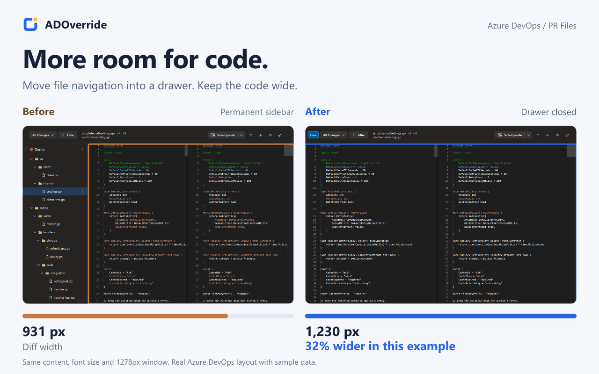
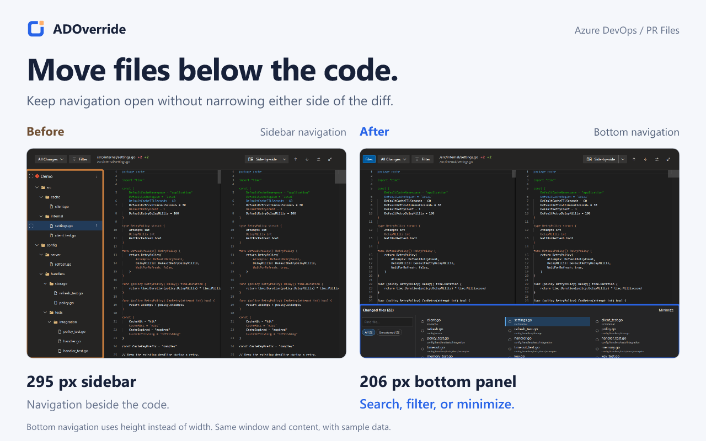
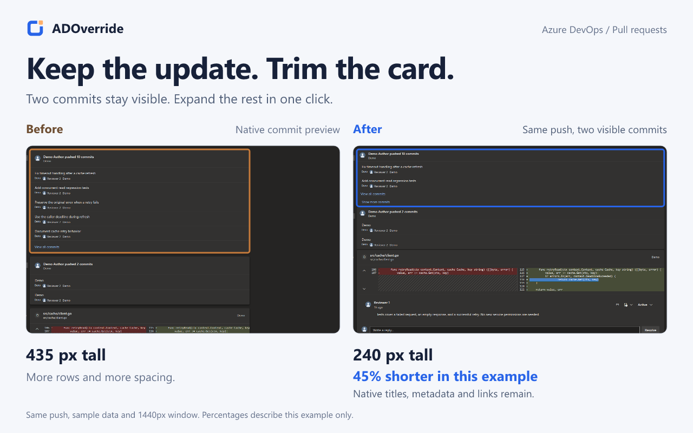
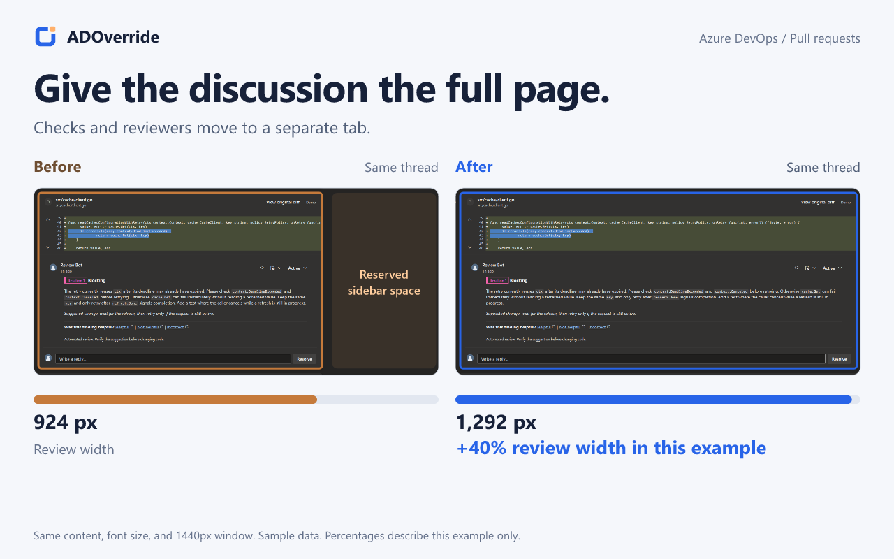
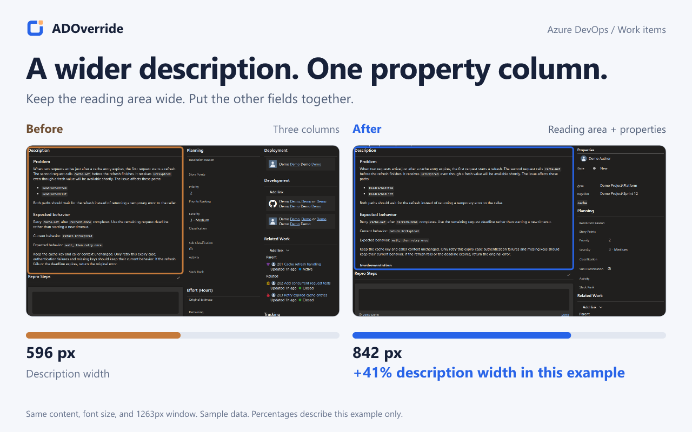

# ADOverride

ADOverride is a Chrome extension for changing how Azure DevOps pages look. It only changes your view, not work item data or what other people see.

**[Install from Chrome Web Store](https://chromewebstore.google.com/detail/adoverride-azure-devops-b/ijeoidnjoamdkpfgbnhfajddhpakobjo)** | [Download](https://github.com/sinmentis/adoverride/releases/latest) | [Guide](docs/guide.md)

## Pull requests

- Give code the full width with a searchable file drawer or bottom panel. Keep the native PR header, comments, and actions.
- Split **Activity**, **Description**, and **Checks** into separate tabs. Each section uses the full width.
- Keep every update visible, with two commits previewed per push. Expand the rest in one click.
- Hide unused PR tabs and duplicate reviewer avatars. Fold passed checks and reviewers who have not voted.
- Fold resolved threads from bots or other authors you choose. Active and pending threads stay visible.

## Work items

- Show or hide supported pages, sections, and individual fields.
- Drag sections to rearrange the page, or use **Workspace** for a wide reading area and a properties sidebar.
- Lock your layout, undo your last change, and save or share presets.

**Boards:** widen columns, hide card fields, reduce spacing, and load more items automatically.

Works on `dev.azure.com` and `*.visualstudio.com`. Some features need English labels; custom layouts may not be supported.

Settings stay local. No ads or analytics. Turn the extension off to restore the page layout without losing your settings.

*Real Azure DevOps pages with sample data. Each comparison uses the same content, font size, and window size. Measurements apply only to the example shown. Click an image to see it full size.*

[Privacy](PRIVACY.md) | [Contributing](CONTRIBUTING.md) | [Security](SECURITY.md) | [MIT](LICENSE)
