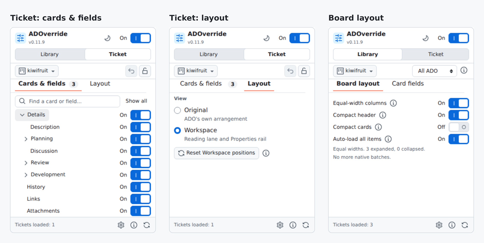

# ADOverride

**Your Azure DevOps. Your way.**

A Chrome extension that declutters Azure DevOps Boards, work items (tickets) and
pull requests. Hide fields, rearrange cards, widen your Kanban Board and cut PR
noise from one small popup.
Your view changes. Your team's setup doesn't.

## Boards that use your screen

Equal-width columns, a compact header, fewer card fields, and automatic
**Show more items** loading.

## Work items without the clutter

Hide optional fields, drag cards where you want them, and read in a wide
Workspace with a Properties rail. Lock your layout or undo your last change.
Works on User Stories, Bugs and any other work item type.

## Pull requests that answer "can this merge?"

Merge status moves to the top of the sidebar with passed checks folded away.
Reviewers who haven't voted collapse into one line, and the activity feed opens
on **Active comments** instead of every push. In **Files**, comment threads
leave the file tree and the tree gets tighter indentation so long paths fit.

## One popup, two layers

**Cards & fields** turns any page, card or field on or off. **Layout** switches
between ADO's own arrangement and Workspace. **Board layout** holds the Kanban
switches, saved per board, project, organization or all of ADO. Start from the
built-in **kiwifruit** preset or save your own.

*Demo screenshots use fictional work items and replayed native layouts.*

## Install

1. Download and extract the Chrome ZIP from [Releases](https://github.com/sinmentis/adoverride/releases), or [build from source](docs/guide.md#from-source).
2. Open `chrome://extensions`, enable **Developer mode**, and choose **Load unpacked**.
3. Select the extracted folder and pin **ADOverride**.

Settings stay local. No telemetry. No automatic work-item updates.

[Guide](docs/guide.md) | [Privacy](PRIVACY.md) | [Contributing](CONTRIBUTING.md) | [Security](SECURITY.md) | [MIT](LICENSE)
