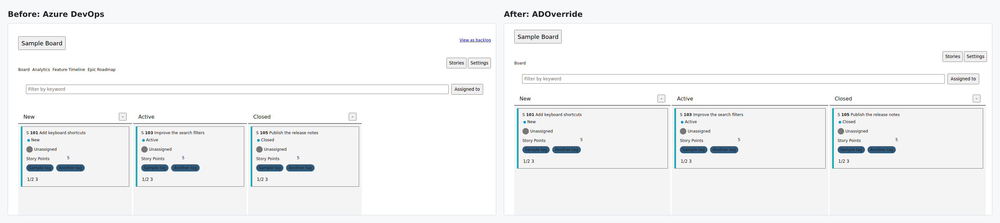

# ADOverride

**Your Azure DevOps. Your way.**

A Chrome extension that declutters Azure DevOps Boards and work items.
Your view changes. Your team's setup doesn't.

## Boards that use your screen

Equal-width columns, a compact header, fewer card fields, and automatic
**Show more items** loading.

## Work items without the clutter

Hide optional fields, drag cards where you want them, and read in a wide
Workspace with a Properties rail. Lock your layout or undo your last change.

*Demo screenshots use fictional work items and replayed native layouts.*

## Install

1. Download and extract the Chrome ZIP from [Releases](https://github.com/sinmentis/adoverride/releases), or [build from source](docs/guide.md#from-source).
2. Open `chrome://extensions`, enable **Developer mode**, and choose **Load unpacked**.
3. Select the extracted folder and pin **ADOverride**.

Settings stay local. No telemetry. No automatic work-item updates.

[Guide](docs/guide.md) | [Development](docs/guide.md#development-and-contributions) | [MIT](LICENSE)
