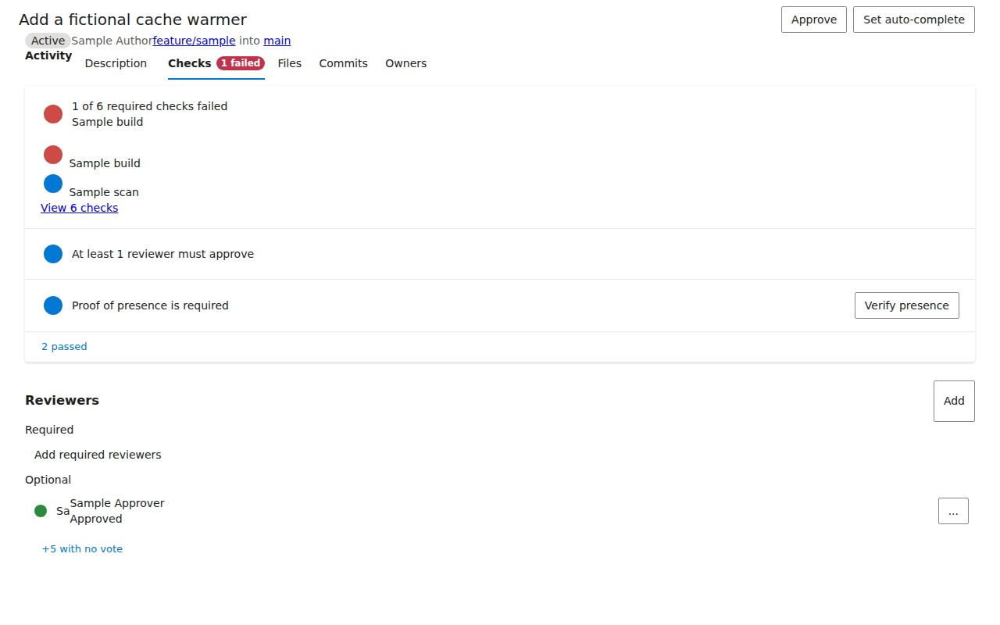
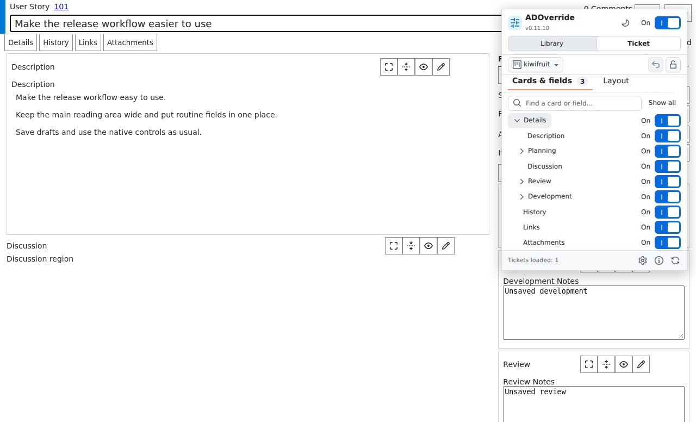

# ADOverride

ADOverride is a Chrome extension for changing how Azure DevOps pages look. It only changes your view, not work item data or what other people see.

**[Install from Chrome Web Store](https://chromewebstore.google.com/detail/adoverride-azure-devops-b/ijeoidnjoamdkpfgbnhfajddhpakobjo)** | [Download](https://github.com/sinmentis/adoverride/releases/latest) | [Guide](docs/guide.md)

## Pull requests

- Split **Activity**, **Description**, and **Checks** into separate tabs. Each section uses the full width.
- Hide unused PR tabs and duplicate reviewer avatars. Fold passed checks, reviewers who have not voted, and repeated push updates.
- Fold resolved threads from bots or other authors you choose. Active and pending threads stay visible.

## Work items

- Show or hide supported pages, sections, and individual fields.
- Drag sections to rearrange the page, or use **Workspace** for a wide reading area and a properties sidebar.
- Lock your layout, undo your last change, and save or share presets.

**Boards:** widen columns, hide card fields, reduce spacing, and load more items automatically.

Works on `dev.azure.com` and `*.visualstudio.com`. Some features need English labels; custom layouts may not be supported.

Settings stay local. No ads or analytics. Turn the extension off to restore the page layout without losing your settings.

*Screenshots use fictional work items and replayed layouts. Click an image to see it full size.*

[Privacy](PRIVACY.md) | [Contributing](CONTRIBUTING.md) | [Security](SECURITY.md) | [MIT](LICENSE)
