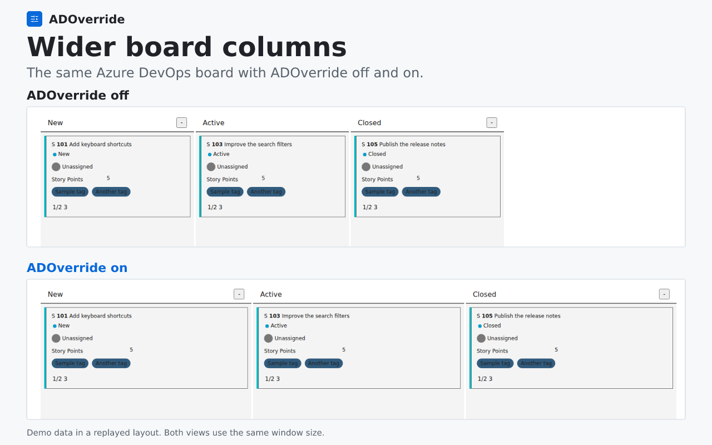
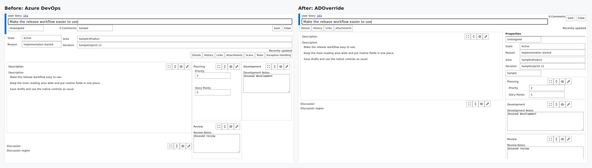

# ADOverride

ADOverride changes the layout of Azure DevOps boards and work items in Chrome. You can hide fields, move sections in work items, and make board columns wider. It only changes your view, not work item data or what other people see.

For Azure DevOps Services on `dev.azure.com` and `*.visualstudio.com`.

**[Install from Chrome Web Store](https://chromewebstore.google.com/detail/adoverride-azure-devops-b/ijeoidnjoamdkpfgbnhfajddhpakobjo)** | [Getting started](docs/guide.md#install-in-chrome) | [Manual install / build from source](docs/guide.md#manual-install)

**The store version is v0.11.10.** It supports Boards and work items. Pull request support is on `main` (v0.11.17), but **is not in the store version yet**.

## Get started

1. Install from the store, pin **ADOverride**, and open an Azure DevOps Kanban board or work item.
2. Click the extension icon. **Library** has the Board settings. **Ticket** has the work item settings.
3. Turn individual options on or off.

The default preset applies automatically and hides some work item fields. Use **Ticket > Cards & fields > Show all** to show them again. The switch at the top of the popup turns off layout changes and keeps your saved settings.

Chrome updates store installations automatically. Use manual installation only for development or trying a build that is not in the store.

## Boards

Make columns fill the available width, reduce header spacing, and choose which fields appear on cards. The extension can also load more items automatically under your current filters. Save settings for one board, a project, an organization, or all supported sites.

## Work items

Show or hide supported pages, sections, and fields. Move sections, or use **Workspace** to put the main text in a wide column and other fields in a sidebar. You can lock the layout or undo your last change. Supported forms include User Stories and Bugs.

You can save presets and export or import settings as JSON. The [guide](docs/guide.md) explains each control.

## Compatibility

Some features need English page labels. Board layout changes work on supported Kanban boards, not every Backlog, Query, sprint, or custom layout. Parts the extension does not recognize stay unchanged. Azure DevOps Server on other domains is not supported.

## Privacy

Settings stay in your browser. The extension reads the current Azure DevOps page address and layout, and gets form-layout information from your organization using your existing sign-in. It does not send your work item data to the developer or save changes to your work items. There are no ads or analytics. [Privacy policy](PRIVACY.md).

*Screenshots use fictional work items and replayed layouts.*

## Pull requests (not yet in the store)

The version on `main` splits Overview into **Activity**, **Description**, and **Checks** tabs. Each tab uses the full width. You can fold passed checks, repeated updates, and resolved threads from selected authors. Active and pending threads stay visible. [PR settings](docs/guide.md#tidy-a-pull-request) | [Build from source](docs/guide.md#from-source).

[Guide](docs/guide.md) | [Privacy](PRIVACY.md) | [Contributing](CONTRIBUTING.md) | [Security](SECURITY.md) | [MIT](LICENSE)
